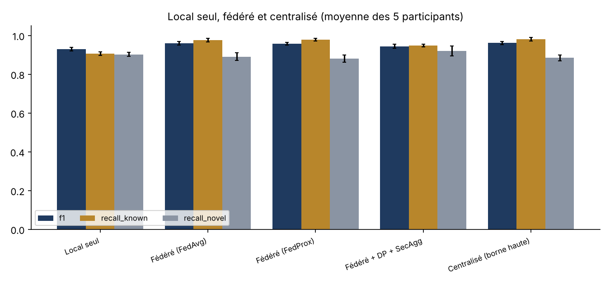
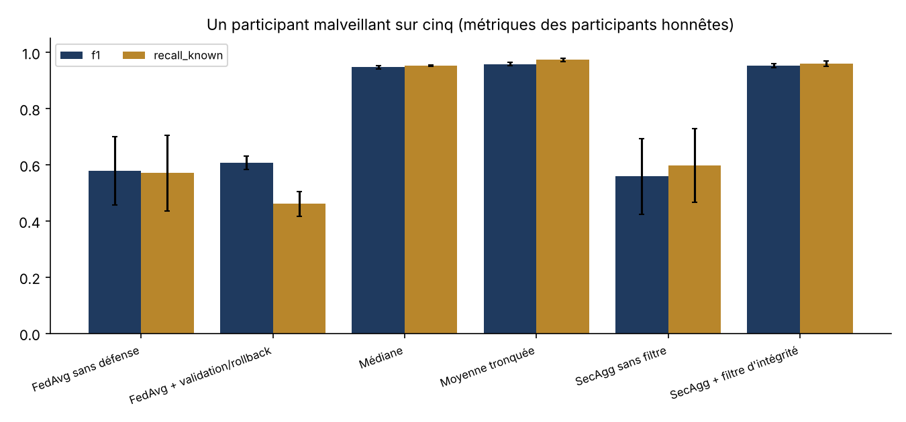
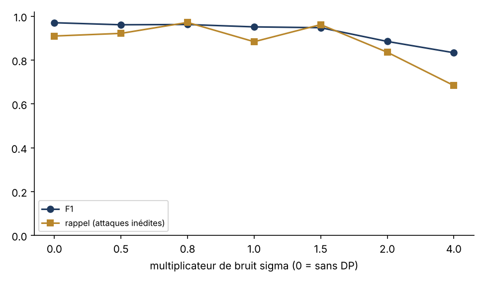

# Résultats

## Local seul, fédéré, centralisé

Moyenne ± écart-type sur les graines, test sur attaques connues et inédites.

| Configuration | recall | precision | fpr | f1 | recall_known | recall_novel |
|---|---|---|---|---|---|---|
| Local seul | 0.906 ± 0.009 | 0.956 ± 0.012 | 0.014 ± 0.004 | 0.930 ± 0.010 | 0.907 ± 0.009 | 0.902 ± 0.011 |
| Fédéré (FedAvg) | 0.955 ± 0.011 | 0.965 ± 0.009 | 0.012 ± 0.003 | 0.960 ± 0.009 | 0.976 ± 0.009 | 0.891 ± 0.020 |
| Fédéré (FedProx) | 0.954 ± 0.010 | 0.962 ± 0.006 | 0.013 ± 0.002 | 0.958 ± 0.007 | 0.978 ± 0.007 | 0.881 ± 0.018 |
| Fédéré + DP + SecAgg | 0.941 ± 0.012 | 0.948 ± 0.007 | 0.017 ± 0.003 | 0.944 ± 0.010 | 0.948 ± 0.008 | 0.921 ± 0.025 |
| Centralisé (borne haute) | 0.957 ± 0.010 | 0.965 ± 0.008 | 0.012 ± 0.003 | 0.961 ± 0.009 | 0.981 ± 0.009 | 0.885 ± 0.015 |

## Empoisonnement (1 participant sur 5, mises à jour inversées et amplifiées x10)

| Configuration | recall | precision | fpr | f1 | recall_known | recall_novel |
|---|---|---|---|---|---|---|
| FedAvg sans défense | 0.552 ± 0.125 | 0.749 ± 0.032 | 0.063 ± 0.027 | 0.579 ± 0.121 | 0.571 ± 0.134 | 0.496 ± 0.100 |
| FedAvg + validation/rollback | 0.487 ± 0.024 | 0.831 ± 0.022 | 0.033 ± 0.003 | 0.607 ± 0.023 | 0.461 ± 0.045 | 0.567 ± 0.051 |
| Médiane | 0.938 ± 0.003 | 0.957 ± 0.011 | 0.014 ± 0.004 | 0.947 ± 0.006 | 0.954 ± 0.002 | 0.891 ± 0.004 |
| Moyenne tronquée | 0.958 ± 0.007 | 0.960 ± 0.006 | 0.013 ± 0.002 | 0.959 ± 0.006 | 0.973 ± 0.006 | 0.912 ± 0.012 |
| SecAgg sans filtre | 0.592 ± 0.121 | 0.645 ± 0.165 | 0.138 ± 0.146 | 0.559 ± 0.134 | 0.597 ± 0.131 | 0.576 ± 0.093 |
| SecAgg + filtre d'intégrité | 0.937 ± 0.010 | 0.971 ± 0.006 | 0.010 ± 0.002 | 0.953 ± 0.008 | 0.960 ± 0.010 | 0.866 ± 0.014 |

## Compromis confidentialité / précision (DP-SGD + SecAgg)

| sigma | epsilon (delta=1e-5, 20 rounds) | F1 | rappel | rappel inédites |
|---|---|---|---|---|
| 0.0 | infini (pas de DP) | 0.971 | 0.968 | 0.910 |
| 0.5 | 184.3 | 0.961 | 0.958 | 0.922 |
| 0.8 | 24.2 | 0.962 | 0.968 | 0.972 |
| 1.0 | 15.3 | 0.952 | 0.943 | 0.884 |
| 1.5 | 7.8 | 0.948 | 0.946 | 0.962 |
| 2.0 | 5.3 | 0.885 | 0.871 | 0.836 |
| 4.0 | 2.4 | 0.834 | 0.781 | 0.684 |

